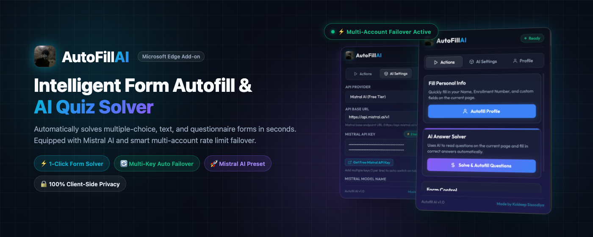
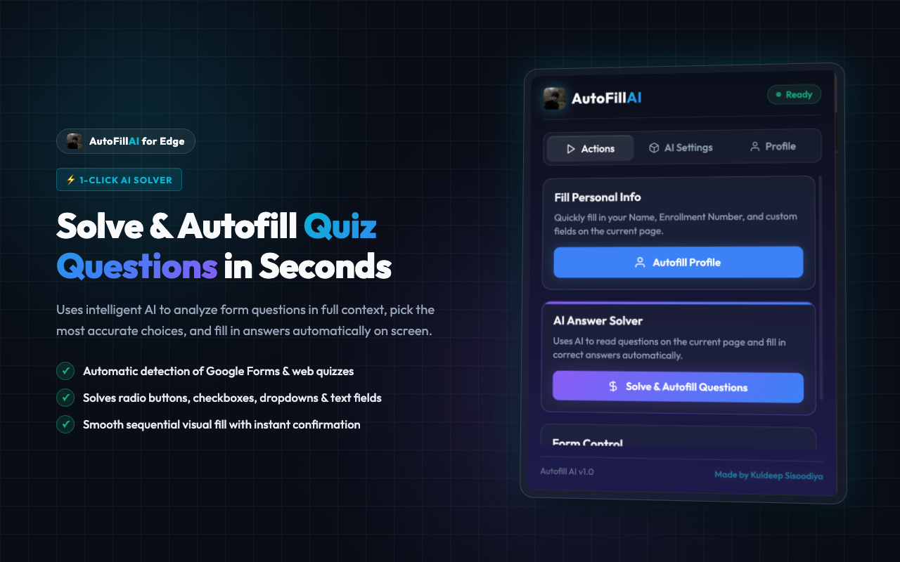
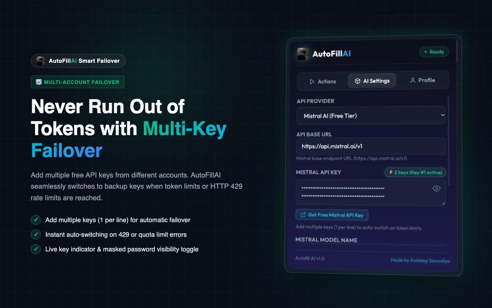
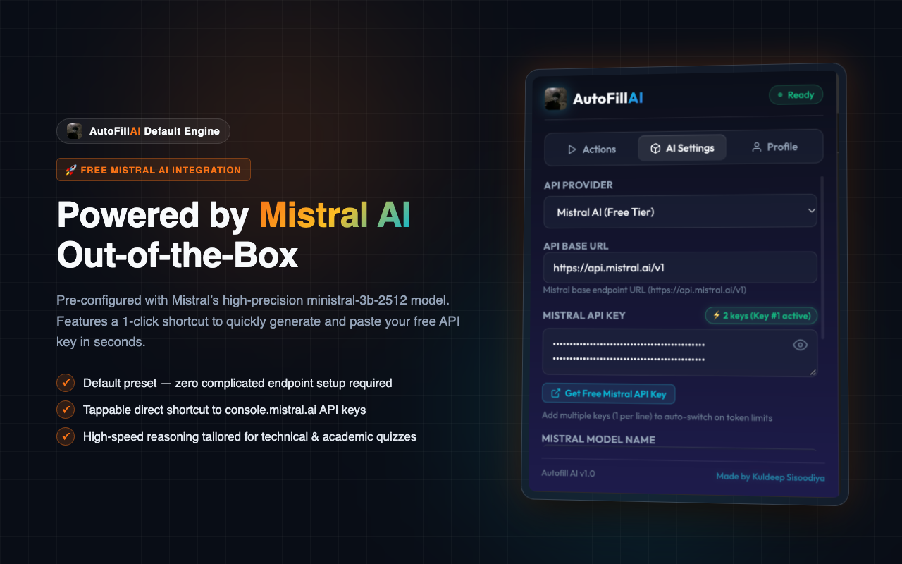
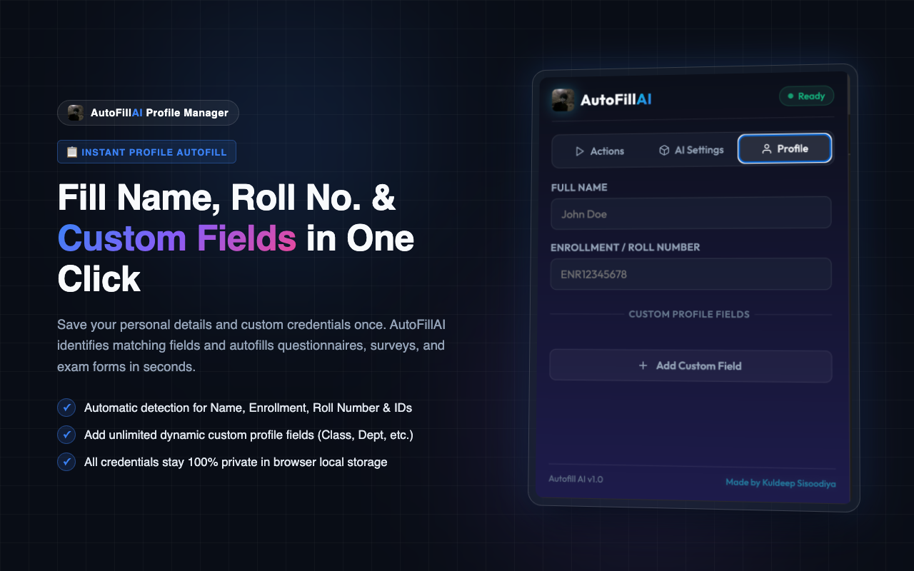
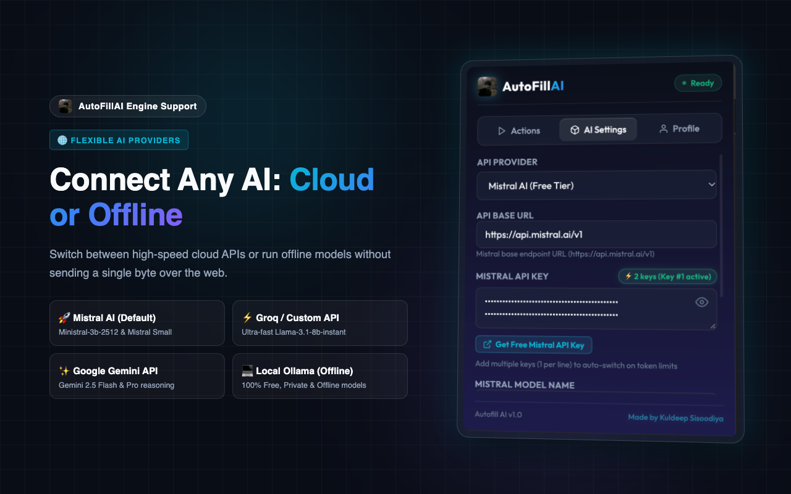

<div align="center">

  

  # AutoFillAI
  ### Intelligent Form Autofill & AI Quiz Solver for Microsoft Edge & Chrome

  [](https://developer.chrome.com/docs/extensions/mv3/intro/)
  [](https://microsoftedge.microsoft.com/addons)
  [](https://console.mistral.ai/)
  [](PRIVACY.md)
  [](LICENSE)

  <br />

  

</div>

<br />

---

## 📌 Overview

**AutoFillAI** is a high-speed, privacy-first browser extension designed to eliminate repetitive typing on online forms, surveys, and academic quizzes. Powered by advanced AI (featuring **Mistral AI** out-of-the-box, **Groq**, **Google Gemini**, and **Local Ollama**), AutoFillAI reads entire questions in full context, accurately identifies answers, and completes form elements on screen with a smooth sequential animation.

With built-in **Multi-Account API Key Failover**, you can configure multiple free API keys. If your primary key hits a token limit or rate limit (HTTP 429), AutoFillAI automatically switches to your backup key on the fly without interrupting your quiz!

---

## 🌟 Key Features

### ⚡ 1. Actions-First Workflow
Opens directly to the **Actions** tab for instant 1-click solving and autofilling without navigating through nested menus.

### 🔄 2. Smart Multi-Key Auto Failover *(New)*
Add multiple API keys (from different free accounts) separated by newlines or commas. If one key hits token limits or rate limits (HTTP 429 / quota exceeded), AutoFillAI automatically cycles to your backup key without interrupting your progress.

### 🚀 3. Mistral AI Default Preset
Pre-configured with Mistral’s high-precision `ministral-3b-2512` model for fast, academic-grade reasoning. Includes a 1-click shortcut button to instantly grab a free API key from [console.mistral.ai](https://console.mistral.ai/api-keys/).

### 🤖 4. Context-Aware AI Solver
Submits all page questions together so the AI understands full quiz context (ideal for technical subjects, cellular communication, microprocessors, engineering, etc.), maximizing accuracy on:
- Radio buttons (Single Choice)
- Checkboxes (Multiple Choice)
- Dropdowns & Selection lists
- Short-answer text fields & textareas

### 📋 5. Personal Profile Autofill
Save your Full Name, Enrollment/Roll Number, and custom profile fields (Class, Department, Year, Email). AutoFillAI automatically detects matching fields across the webpage and fills them in one click.

### 🌐 6. Multi-Provider Flexibility
Choose the AI engine that fits your workflow:
- **Mistral AI (Free Tier)**: Fast, accurate reasoning (`ministral-3b-2512`).
- **Groq Llama-3.1 (High-Speed Free Tier)**: Blazing fast response times (`llama-3.1-8b-instant`).
- **Google Gemini API**: Direct connection via Gemini 2.5 Flash / Pro.
- **Local Ollama (100% Free & Offline)**: Connects to `http://localhost:11434/v1` for completely offline, private solving with zero internet required.
- **Custom Endpoints**: Compatible with any OpenAI-standard endpoint.

### 🎨 7. Smooth Sequential Fill Animation
Answers are highlighted and filled sequentially with a smooth 200ms delay, giving you clear visual confirmation of every answered question.

### 🔒 8. 100% Client-Side Privacy
Your credentials, API keys, and profile details stay strictly in your browser's private local storage (`chrome.storage.local`). No external developer servers, telemetry, or analytics are used.

---

## 📸 Screenshots

<div align="center">

### 1. Actions & 1-Click AI Solver


<br /><br />

### 2. Multi-Key Rotation & Auto Failover


<br /><br />

### 3. Mistral AI Default Preset & 1-Click Key Setup


<br /><br />

### 4. Personal Profile & Custom Fields Autofill


<br /><br />

### 5. Multi-Provider AI Engine Support


</div>

---

## 🛠️ Installation Guide

### Microsoft Edge:
1. Download or clone this repository:
   ```bash
   git clone https://github.com/kuldeepsisodiya/AutoFillAI.git
   ```
2. Open Microsoft Edge and navigate to `edge://extensions/`.
3. Enable **Developer mode** using the toggle in the left sidebar.
4. Click **Load unpacked** and select the `Autofiller` folder.

### Google Chrome:
1. Clone or download this repository.
2. Open Google Chrome and navigate to `chrome://extensions/`.
3. Enable **Developer mode** using the toggle in the top-right corner.
4. Click **Load unpacked** and select the `Autofiller` folder.

---

## ⚙️ Quick Start & Configuration

1. **Open the Extension**: Click the AutoFillAI icon in your browser toolbar.
2. **Configure AI Settings**:
   - The default provider is **Mistral AI (Free Tier)**.
   - Click the **"Get Free Mistral API Key"** button to open [console.mistral.ai/api-keys](https://console.mistral.ai/api-keys/) and generate your free key.
   - Paste your key into the API Key box.
   - *(Optional)* Paste backup keys on new lines for automatic failover (`⚡ 2 keys active`).
3. **Configure Your Profile**:
   - In the **Profile** tab, enter your Full Name, Enrollment/Roll number, and any custom fields (e.g., Section, Department).
4. **Solve & Autofill**:
   - Navigate to any quiz or form (such as Google Forms).
   - Click the extension icon and hit **"Solve & Autofill Questions"** or **"Autofill Profile"**!

---

## 🔒 Privacy & Security

- AutoFillAI runs **entirely inside your browser**.
- Your API keys and profile information are stored exclusively in `chrome.storage.local`.
- External requests are made **only** directly between your browser and the AI provider API you configure.
- Read our full [Privacy Policy](PRIVACY.md).

---

## 👨‍💻 Author

Developed with ❤️ by **[Kuldeep Sisoodiya](https://github.com/kuldeepsisodiya)**

If you found this project helpful, please consider giving it a ⭐ on GitHub!
